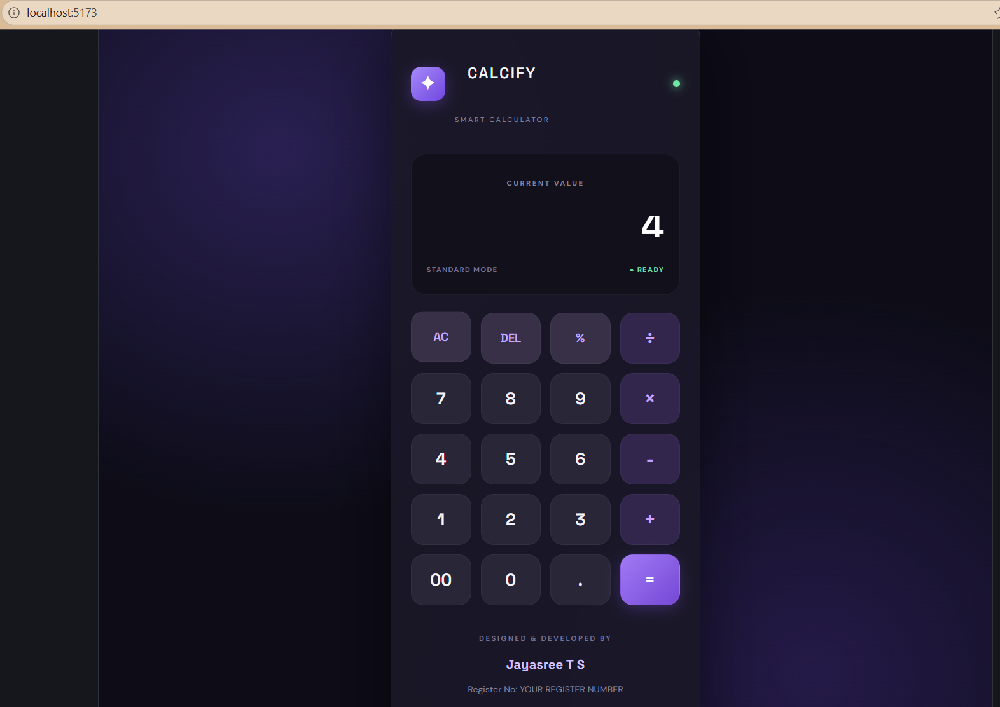

# Ex04 Simple Calculator - React Project
## Date:14-03-2026
## Name : Jayasree T S
## Reg No : 212224040135

## AIM
To  develop a Simple Calculator using React.js with clean and responsive design, ensuring a smooth user experience across different screen sizes.

## ALGORITHM
### STEP 1
Create a React App.

### STEP 2
Open a terminal and run:
  <ul><li>npx create-react-app simple-calculator</li>
  <li>cd simple-calculator</li>
  <li>npm start</li></ul>

### STEP 3
Inside the src/ folder, create a new file Calculator.js and define the basic structure.

### STEP 4
Plan the UI: Display screen, number buttons (0-9), operators (+, -, *, /), clear (C), and equal (=).

### STEP 5
Create a new file Calculator.css in src/ and add the styling.

### STEP 6
Open src/App.js and modify it.

### STEP 7
Start the development server.
  npm start

### STEP 8
Open http://localhost:3000/ in the browser.

### STEP 9
Test the calculator by entering numbers and operations.

### STEP 10
Fix styling issues and refine content placement.

### STEP 11
Deploy the website.

### STEP 12
Upload to GitHub Pages for free hosting.

## PROGRAM
 
app.jsx
```

import { useState, useEffect } from 'react'
import './App.css'

function App() {
  const [display, setDisplay] = useState('0')
  const [previous, setPrevious] = useState(null)
  const [operator, setOperator] = useState(null)
  const [waiting, setWaiting] = useState(false)

  const formatNumber = (number) => {
    if (!Number.isFinite(number)) return 'Error'
    return String(Number(number.toFixed(10)))
  }

  const inputDigit = (digit) => {
    if (display === 'Error') {
      setDisplay(digit)
      setWaiting(false)
      return
    }

    if (waiting) {
      setDisplay(digit)
      setWaiting(false)
    } else {
      setDisplay(display === '0' ? digit : display + digit)
    }
  }

  const inputDecimal = () => {
    if (display === 'Error' || waiting) {
      setDisplay('0.')
      setWaiting(false)
      return
    }

    if (!display.includes('.')) {
      setDisplay(display + '.')
    }
  }

  const clearAll = () => {
    setDisplay('0')
    setPrevious(null)
    setOperator(null)
    setWaiting(false)
  }

  const deleteLast = () => {
    if (display === 'Error' || waiting) {
      setDisplay('0')
      setWaiting(false)
      return
    }

    setDisplay(display.length > 1 ? display.slice(0, -1) : '0')
  }

  const calculate = (first, second, op) => {
    switch (op) {
      case '+': return first + second
      case '-': return first - second
      case '×': return first * second
      case '÷': return second === 0 ? 'Error' : first / second
      default: return second
    }
  }

  const chooseOperator = (nextOperator) => {
    if (display === 'Error') return

    const inputValue = Number(display)

    if (operator && !waiting) {
      const result = calculate(previous, inputValue, operator)

      if (result === 'Error') {
        setDisplay('Error')
        setPrevious(null)
        setOperator(null)
        setWaiting(true)
        return
      }

      const formatted = formatNumber(result)
      setDisplay(formatted)
      setPrevious(result)
    } else {
      setPrevious(inputValue)
    }

    setOperator(nextOperator)
    setWaiting(true)
  }

  const performCalculation = () => {
    if (operator === null || previous === null || display === 'Error') return

    const result = calculate(previous, Number(display), operator)
    setDisplay(formatNumber(result))
    setPrevious(null)
    setOperator(null)
    setWaiting(true)
  }

  const percentage = () => {
    if (display === 'Error') return
    setDisplay(formatNumber(Number(display) / 100))
    setWaiting(false)
  }

  useEffect(() => {
    const handleKeyDown = (event) => {
      const key = event.key

      if (/^[0-9]$/.test(key)) inputDigit(key)
      else if (key === '.') inputDecimal()
      else if (key === '+') chooseOperator('+')
      else if (key === '-') chooseOperator('-')
      else if (key === '*') chooseOperator('×')
      else if (key === '/') {
        event.preventDefault()
        chooseOperator('÷')
      }
      else if (key === 'Enter' || key === '=') performCalculation()
      else if (key === 'Backspace') deleteLast()
      else if (key === 'Escape') clearAll()
      else if (key === '%') percentage()
    }

    window.addEventListener('keydown', handleKeyDown)
    return () => window.removeEventListener('keydown', handleKeyDown)
  })

  const buttons = [
    { label: 'AC', type: 'utility', action: clearAll },
    { label: 'DEL', type: 'utility', action: deleteLast },
    { label: '%', type: 'utility', action: percentage },
    { label: '÷', type: 'operator', action: () => chooseOperator('÷') },

    { label: '7', action: () => inputDigit('7') },
    { label: '8', action: () => inputDigit('8') },
    { label: '9', action: () => inputDigit('9') },
    { label: '×', type: 'operator', action: () => chooseOperator('×') },

    { label: '4', action: () => inputDigit('4') },
    { label: '5', action: () => inputDigit('5') },
    { label: '6', action: () => inputDigit('6') },
    { label: '-', type: 'operator', action: () => chooseOperator('-') },

    { label: '1', action: () => inputDigit('1') },
    { label: '2', action: () => inputDigit('2') },
    { label: '3', action: () => inputDigit('3') },
    { label: '+', type: 'operator', action: () => chooseOperator('+') },

    { label: '00', action: () => inputDigit('0') && inputDigit('0') },
    { label: '0', action: () => inputDigit('0') },
    { label: '.', action: inputDecimal },
    { label: '=', type: 'equals', action: performCalculation }
  ]

  return (
    <main className="app-container">
      <div className="calculator">

        <header className="calc-header">
          <div className="brand">
            <div className="brand-icon">✦</div>
            <div>
              <h1>CALCIFY</h1>
              <p>SMART CALCULATOR</p>
            </div>
          </div>
          <span className="status-dot"></span>
        </header>

        <section className="display-section">
          <p className="display-label">CURRENT VALUE</p>
          <div className="display">
            <span className="display-number">{display}</span>
          </div>
          <div className="display-bottom">
            <span>STANDARD MODE</span>
            <span>● READY</span>
          </div>
        </section>

        <section className="button-grid">
          {buttons.map((button, index) => (
            <button
              key={index}
              className={`calc-button ${button.type || ''} ${
                button.type === 'operator' && operator === button.label
                  ? 'active'
                  : ''
              }`}
              onClick={button.action}
              aria-label={button.label}
            >
              {button.label}
            </button>
          ))}
        </section>

        <footer className="calc-footer">
          <p>DESIGNED & DEVELOPED BY</p>
          <h3>Jayasree T S</h3>
          <span>Register No: YOUR REGISTER NUMBER</span>
          <div className="footer-line"></div>
          <small>© 2026 CALCIFY · ALL RIGHTS RESERVED</small>
        </footer>

      </div>
    </main>
  )
}

export default App

```

app.css

```


@import url('https://fonts.googleapis.com/css2?family=DM+Sans:wght@400;500;600;700;800&family=Space+Grotesk:wght@400;500;600;700&display=swap');

* {
  margin: 0;
  padding: 0;
  box-sizing: border-box;
}

body {
  font-family: 'DM Sans', sans-serif;
}

.app-container {
  min-height: 100vh;
  width: 100%;
  display: flex;
  align-items: center;
  justify-content: center;
  padding: 35px 16px;
  background:
    radial-gradient(ellipse at 20% 20%, #292052 0%, transparent 40%),
    radial-gradient(ellipse at 80% 85%, #241a48 0%, transparent 40%),
    #0d0c17;
  color: #fff;
}

.calculator {
  width: 100%;
  max-width: 390px;
  padding: 25px;
  border: 1px solid rgba(255, 255, 255, 0.09);
  border-radius: 27px;
  background: rgba(25, 23, 39, 0.94);
  box-shadow: 0 25px 80px rgba(0, 0, 0, 0.45);
}

.calc-header {
  display: flex;
  align-items: center;
  justify-content: space-between;
  margin-bottom: 30px;
}

.brand {
  display: flex;
  align-items: center;
  gap: 12px;
}

.brand-icon {
  width: 43px;
  height: 43px;
  display: grid;
  place-items: center;
  border-radius: 13px;
  background: linear-gradient(135deg, #a78bfa, #7046df);
  font-size: 25px;
  box-shadow: 0 5px 20px rgba(139, 92, 246, 0.3);
}

.brand h1 {
  font-family: 'Space Grotesk', sans-serif;
  font-size: 19px;
  letter-spacing: 2px;
}

.brand p {
  color: #88839c;
  font-size: 9px;
  letter-spacing: 2px;
  margin-top: 3px;
}

.status-dot {
  width: 9px;
  height: 9px;
  border-radius: 50%;
  background: #72e5a5;
  box-shadow: 0 0 12px #72e5a5;
}

.display-section {
  padding: 23px 19px 18px;
  margin-bottom: 22px;
  border-radius: 19px;
  background: #11101b;
  border: 1px solid rgba(255, 255, 255, 0.06);
}

.display-label {
  font-size: 9px;
  letter-spacing: 2px;
  color: #88839c;
  font-weight: 700;
}

.display {
  display: flex;
  align-items: center;
  justify-content: flex-end;
  min-height: 83px;
  overflow: hidden;
}

.display-number {
  font-family: 'Space Grotesk', sans-serif;
  font-size: clamp(34px, 9vw, 46px);
  font-weight: 600;
  color: #fff;
  white-space: nowrap;
  overflow-x: auto;
  scrollbar-width: none;
}

.display-bottom {
  display: flex;
  justify-content: space-between;
  color: #77718d;
  font-size: 9px;
  letter-spacing: 1px;
  font-weight: 700;
}

.display-bottom span:last-child {
  color: #72dca2;
}

.button-grid {
  display: grid;
  grid-template-columns: repeat(4, 1fr);
  gap: 12px;
}

.calc-button {
  height: 64px;
  border: 1px solid rgba(255, 255, 255, 0.045);
  border-radius: 16px;
  background: #292638;
  color: #f5f3fc;
  font-family: 'Space Grotesk', sans-serif;
  font-size: 21px;
  font-weight: 600;
  cursor: pointer;
  transition: transform 0.15s, background 0.15s, box-shadow 0.15s;
}

.calc-button:hover {
  background: #39344e;
  transform: translateY(-2px);
}

.calc-button:active {
  transform: scale(0.94);
}

.calc-button.utility {
  background: #373047;
  color: #c6aaff;
  font-size: 15px;
}

.calc-button.operator {
  background: #33264d;
  color: #c6a5ff;
  font-size: 24px;
}

.calc-button.operator:hover,
.calc-button.operator.active {
  background: #6544a3;
  color: white;
}

.calc-button.equals {
  background: linear-gradient(135deg, #a17af5, #7548d5);
  color: white;
  box-shadow: 0 5px 18px rgba(139, 92, 246, 0.25);
}

.calc-button.equals:hover {
  background: linear-gradient(135deg, #b493ff, #855ce8);
  box-shadow: 0 7px 23px rgba(139, 92, 246, 0.4);
}

.calc-footer {
  text-align: center;
  margin-top: 29px;
}

.calc-footer p {
  color: #77718d;
  font-size: 9px;
  letter-spacing: 2px;
  font-weight: 700;
}

.calc-footer h3 {
  margin-top: 7px;
  color: #d4c2ff;
  font-family: 'Space Grotesk', sans-serif;
  font-size: 16px;
}

.calc-footer span {
  display: block;
  margin-top: 5px;
  color: #88839c;
  font-size: 11px;
}

.footer-line {
  height: 1px;
  background: rgba(255, 255, 255, 0.08);
  margin: 19px 0 13px;
}

.calc-footer small {
  color: #625d75;
  font-size: 9px;
  letter-spacing: 1px;
}

@media (max-width: 420px) {
  .calculator {
    padding: 19px;
    border-radius: 22px;
  }

  .calc-button {
    height: 59px;
    border-radius: 13px;
  }

  .button-grid {
    gap: 9px;
  }
}

@media (max-height: 650px) {
  .app-container {
    align-items: flex-start;
  }
}


```
index.css

```
:root {
  --text: #6b6375;
  --text-h: #08060d;
  --bg: #fff;
  --border: #e5e4e7;
  --code-bg: #f4f3ec;
  --accent: #aa3bff;
  --accent-bg: rgba(170, 59, 255, 0.1);
  --accent-border: rgba(170, 59, 255, 0.5);
  --social-bg: rgba(244, 243, 236, 0.5);
  --shadow:
    rgba(0, 0, 0, 0.1) 0 10px 15px -3px, rgba(0, 0, 0, 0.05) 0 4px 6px -2px;

  --sans: system-ui, 'Segoe UI', Roboto, sans-serif;
  --heading: system-ui, 'Segoe UI', Roboto, sans-serif;
  --mono: ui-monospace, Consolas, monospace;

  font: 18px/145% var(--sans);
  letter-spacing: 0.18px;
  color-scheme: light dark;
  color: var(--text);
  background: var(--bg);
  font-synthesis: none;
  text-rendering: optimizeLegibility;
  -webkit-font-smoothing: antialiased;
  -moz-osx-font-smoothing: grayscale;

  @media (max-width: 1024px) {
    font-size: 16px;
  }
}

@media (prefers-color-scheme: dark) {
  :root {
    --text: #9ca3af;
    --text-h: #f3f4f6;
    --bg: #16171d;
    --border: #2e303a;
    --code-bg: #1f2028;
    --accent: #c084fc;
    --accent-bg: rgba(192, 132, 252, 0.15);
    --accent-border: rgba(192, 132, 252, 0.5);
    --social-bg: rgba(47, 48, 58, 0.5);
    --shadow:
      rgba(0, 0, 0, 0.4) 0 10px 15px -3px, rgba(0, 0, 0, 0.25) 0 4px 6px -2px;
  }

  #social .button-icon {
    filter: invert(1) brightness(2);
  }
}

body {
  margin: 0;
}

#root {
  width: 1126px;
  max-width: 100%;
  margin: 0 auto;
  text-align: center;
  border-inline: 1px solid var(--border);
  min-height: 100svh;
  display: flex;
  flex-direction: column;
  box-sizing: border-box;
}

h1,
h2 {
  font-family: var(--heading);
  font-weight: 500;
  color: var(--text-h);
}

h1 {
  font-size: 56px;
  letter-spacing: -1.68px;
  margin: 32px 0;
  @media (max-width: 1024px) {
    font-size: 36px;
    margin: 20px 0;
  }
}
h2 {
  font-size: 24px;
  line-height: 118%;
  letter-spacing: -0.24px;
  margin: 0 0 8px;
  @media (max-width: 1024px) {
    font-size: 20px;
  }
}
p {
  margin: 0;
}

code,
.counter {
  font-family: var(--mono);
  display: inline-flex;
  border-radius: 4px;
  color: var(--text-h);
}

code {
  font-size: 15px;
  line-height: 135%;
  padding: 4px 8px;
  background: var(--code-bg);
}

```

main.jsx

```
import { StrictMode } from 'react'
import { createRoot } from 'react-dom/client'
import './index.css'
import App from './App.jsx'

createRoot(document.getElementById('root')).render(
  <StrictMode>
    <App />
  </StrictMode>,
)

```


## OUTPUT




## RESULT
The program for developing a simple calculator in React.js is executed successfully.